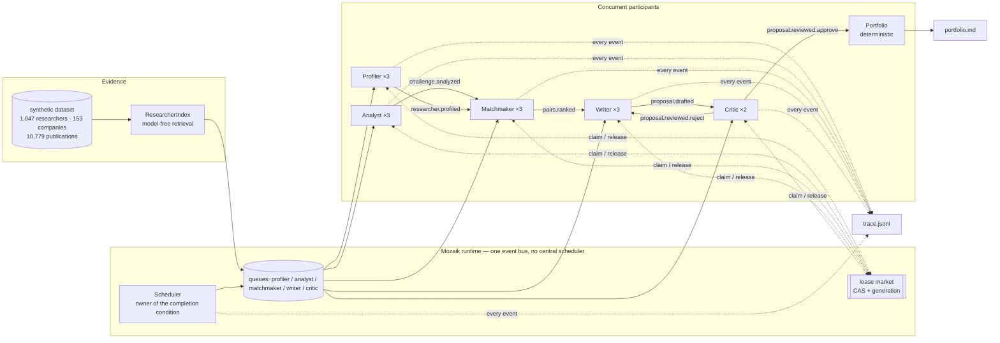

# EUREKA

**An evidence-first researcher–company matchmaker built on [Mozaik](https://github.com/jigjoy-ai/mozaik).**

EUREKA reads a company's real technical challenge, retrieves the researchers whose published
work actually overlaps with it, ranks the pairs, and writes an industrial-PhD or joint-project
proposal for the best ones — with a **Critic that rejects any sentence it cannot trace to a
dataset id**. It runs several agents at the same time, shares one typed state, and claims work
through a lease market instead of following a scripted pipeline.

Built for the **EINSTEIN: Science-to-Business Matchmaker** track of the NTP Novi Sad Hackathon
(30–31 October 2026).

---

## What it does

```
challenge → capability needs → retrieval (no model) → ranked pairs → proposal → claim-level review
```

1. **Industry Analyst** turns each company challenge into the capability the company actually needs.
2. **Retrieval** (deterministic, no model) narrows 1,047 researchers to the handful whose
   keywords, fields and open-to statements genuinely overlap. This happens *before* inference:
   153 companies × 1,047 researchers is 160k pairs, and no budget survives throwing a model at that.
3. **Research Profiler** enriches the strongest candidates with a sourced profile.
4. **Matchmaker** ranks the pairs for that challenge and explains each ranking.
5. **Proposal Writer** drafts a one-page proposal — problem, first-year plan, what each side brings,
   industrial-PhD option, risks.
6. **Critic** checks every citation against the dataset, in code first and with a model second.
   A fabricated paper does not survive: the proposal goes back to the Writer, and if it fails
   twice it is abandoned rather than shipped.
7. **Portfolio** picks at most one collaboration per company, never double-books a researcher,
   and is allowed to leave a challenge unmatched — saying "no defensible pair" is a result.

The output is `runs/<id>/portfolio.md` plus `runs/<id>/trace.jsonl`: every task, its model, its
tokens, its cost and its duration.

---

## Why this is not a pipeline in disguise

A pipeline is a script that calls A, then B, then C. Here, **nobody calls anybody**:

- Every participant is an `Agent` or `Human` joined to one Mozaik runtime.
- Work is published as events (`work.available`, `challenge.analyzed`, `pairs.ranked`,
  `proposal.drafted`, `proposal.reviewed`).
- A worker **claims** an item from a queue through a lease market that carries a generation
  (`src/domain/market.ts`). A stale worker's write is discarded: `market.isCurrent(key, generation)`.
- Workers of the same role compete for the same queue. Adding a worker adds throughput; it does
  not change the code.
- The only coordinating participant, the **Scheduler**, owns no work. It publishes the initial
  work and closes the run when the market and the queues are empty. Remove it after boot and the
  run still drains — it just would not know when to stop.

Measured on the mock run in this repository: **9 model turns in flight at once**, across five
roles, with a max pool of 3. The trace proves it — `inference.started` minus `inference.completed`
over time is the concurrency curve.

---

## How to run it

Requires Node 20+.

```bash
npm install
npm run mock                       # offline, deterministic, no API key, ~1s
npm start                          # real models (needs a provider key)
npm run trace                      # serve the trace viewer at http://localhost:4173
npm run openalex                   # optional: verify the OpenAlex key, pull UNS context
```

`npm run mock` is the honest demo: the runtime, the concurrency, the leases, the Critic and the
trace are all real. Only text generation is replaced by `src/inference/mock.ts`, which is labelled
`mock` in the trace. The first draft deliberately fabricates one citation so the rejection loop
is visible in every run.

### Real models

Copy `.env.example` to `.env` and set **one** provider key (`OPENAI_API_KEY`,
`ANTHROPIC_API_KEY` or `GEMINI_API_KEY`; DeepSeek works through `OPENAI_BASE_URL`).

```bash
EUREKA_MODEL=gpt-5.5             # planner / matchmaker / writer
EUREKA_FAST_MODEL=gpt-5.4-mini   # profiler / analyst / critic
```

Model names must exist in `@mozaik-ai/core`'s `supportedModels` (or pass your own through
`inferenceRunnerConfig`).

### Scale knobs

```bash
npm start -- --companies=10 --challenges=2 --candidates=6 --profile=3 --portfolio=5 \
              --pools=profiler:3,analyst:3,matchmaker:3,writer:3,critic:2
```

| Flag | Default | Meaning |
| --- | --- | --- |
| `--companies` | 6 | Companies to process (dataset has 153) |
| `--challenges` | 2 | Challenges per company (489 in total) |
| `--candidates` | 6 | Researchers retrieved per challenge |
| `--profile` | 3 | Candidates enriched with a model-written profile |
| `--portfolio` | 5 | Collaborations carried into the portfolio |
| `--pools` | 3/3/3/3/2 | Worker-pool size per role |
| `--lease-ttl` | 120000 | Lease lifetime in ms |

---

## Architecture



Full detail, event catalogue and design decisions: [`docs/architecture.md`](docs/architecture.md).

### Layout

```
src/
  domain/       types, dataset loading + retrieval index, lease market
  runtime/      runtime state, event catalogue, session, trace observer
  agents/       generic reactive worker, the five role prompts, pools, scheduler, portfolio
  inference/    mock runner, price table
  index.ts      CLI (run / trace)
  trace-server.ts  zero-dependency viewer server
public/viewer.html   the trace UI
data/data/           vendored synthetic dataset (see provenance below)
```

---

## The claim ledger

The brief's hardest requirement is *"no hallucinations"*. Prompting a model to be careful does not
achieve that, so the system does not rely on it:

- Every factual sentence in a proposal becomes a **Claim** object in `RuntimeState`:
  `{ text, sources[], status: proposed | verified | rejected, note }`.
- The Critic receives a **scoped** list of sources that could legitimately support *this* pair
  (the researcher, their publications, projects and patents, the challenge, the company) — not a
  prompt stuffed with 14k ids.
- **Code resolves every citation before the model's verdict is considered.** If one id does not
  exist in the index, the verdict is `reject` regardless of what the model said.
- Rejections are not silent. They are events (`proposal.reviewed`, `claim.rejected`), they are in
  the trace, and they cost the Writer another turn.
- Two failed revisions and the proposal is abandoned. The portfolio is smaller and honest.

`runs/<id>/portfolio.md` therefore contains only claims whose sources resolve.

---

## How this maps to the judging criteria

| Criterion | Pts | Where it is answered |
| --- | --- | --- |
| Multi-agent architecture: roles, coordination, review loops | 30 | Five role pools on one bus, lease market with generations, Critic→Writer revision loop. `src/agents/`, `src/domain/market.ts` |
| Proposals a company and a researcher would sit down over | 25 | Challenge-specific problem restatement, first-year plan, what each side brings, industrial-PhD option, named risks. `src/agents/roles.ts` (writer), `runs/*/portfolio.md` |
| Accuracy and transparency: sources, trace, no hallucinations | 20 | Claim ledger + code-level citation resolution + `trace.jsonl` with per-task time and cost. `src/agents/roles.ts` (critic), `src/runtime/trace.ts` |
| Potential for real use in EINSTEIN | 15 | Deterministic retrieval scales to the full dataset; portfolio instead of leaderboard; integration sketch below |
| Responsible use of data | 10 | Synthetic dataset only by default; no scoring or ranking of people by worth; "no match" is a first-class outcome; unmatched challenges are reported |

Required extras from the brief: architecture diagram (§Architecture), trace of one full run
showing the Critic (`runs/<id>/trace.jsonl`), and at least three proposals
(`runs/<id>/portfolio.md`).

---

## How this plugs into the EINSTEIN network and EINSTEIN Stars

*Our reading of the brief; the integration points are concrete, the surrounding platform details are assumptions.*

- **Identity and profiles.** A researcher profile is a set of sourced claims, not a score.
  EINSTEIN Stars can consume the same `Claim` records to show *why* someone is a candidate —
  `{ assertion, sourceId, verifiedBy }` — which is exactly the shape a review board needs and
  the shape a leaderboard must not be.
- **Matching as a service.** The runtime exposes a clean seam: `challenge.analyzed` in,
  `proposal.reviewed` out. The network can post real challenges and receive proposals without
  adopting our agents — the deliverable is the event contract, not the CLI.
- **Human approval stays human.** The brief suggests a step where a person approves pairs before
  proposal writing. That is one extra participant subscribing to `pairs.ranked`; the market
  already supports holding work (a lease with no release).
- **Provenance for the network.** Every proposal carries citations into ORCID/OpenAlex-shaped ids.
  Swapping the synthetic index for a live OpenAlex index is a data adapter change
  (`src/domain/dataset.ts`), not an architecture change.

---

## Data

`data/data/` is the organisers' synthetic dataset
([`jigjoy-ai/einstein-matchmaker-data`](https://github.com/jigjoy-ai/einstein-matchmaker-data)),
vendored so the repository runs without network access: 1,047 researchers, 153 companies,
489 challenges, 10,779 publications, 1,823 projects, 111 patents, 917 company pages. Every person
and company is fictional; the faculties are real and used only as a setting.

An optional enrichment probe reads `OPENALEX_API_KEY` from `.env` (free key:
<https://openalex.org/settings/api-key>). It is **not** required for a run, and the pipeline never
sends real people to a model: enrichment is limited to resolving public identifiers.

**Responsible use.** The system proposes collaborations between institutions. It does not score,
rank or rate people by worth. Retrieval ranks *overlap with a stated problem*, and the
`unmatched` list exists so a weak pair is reported as weak rather than dressed up.

---

## Honest limitations

- **Mock mode is deterministic fiction.** It proves the machinery, not the proposal quality.
  Real-mode output quality depends on the provider and the prompt; the Critic guards facts, not taste.
- **Retrieval is lexical.** Serbian Cyrillic and Latin records are not transliterated yet, so a
  Cyrillic-only profile can be under-retrieved. The dataset has 82 such records. Fix: a
  transliteration pass in `tokenize` (`src/domain/dataset.ts`), ~20 lines.
- **Profiles are per-challenge.** The same researcher may be profiled several times for different
  challenges. A cross-run profile cache is the obvious next step.
- **Embeddings would beat keyword overlap** for cross-disciplinary pairs ("formal verification" ×
  "medical devices"). Retrieval is deliberately model-free so the run stays cheap and testable;
  swapping in an embedding index is a single class change behind `ResearcherIndex`.
- **Portfolio is greedy.** No global optimisation (e.g. max-coverage with mutual exclusivity);
  with 153 companies that is a real, if small, quality gap.
- **No persistence between runs.** State lives in memory; `runs/` is the durable artefact.

---

## Trace format

`runs/<id>/trace.jsonl`, one JSON object per event:

```json
{"t":124,"ts":"2026-10-29T19:18:11.333Z","type":"task.measured","producer":"writer-1",
 "summary":"writer P-C001-CH1-R1008 on gpt-5.5: 1273→564 tokens, $0.0072, 4ms"}
```

`npm run trace` serves the viewer (`public/viewer.html`): a timeline with filters, expandable
payloads, live cost/token counters, red rejections and green approvals, plus the portfolio beside it.

---

## Licence

MIT.
