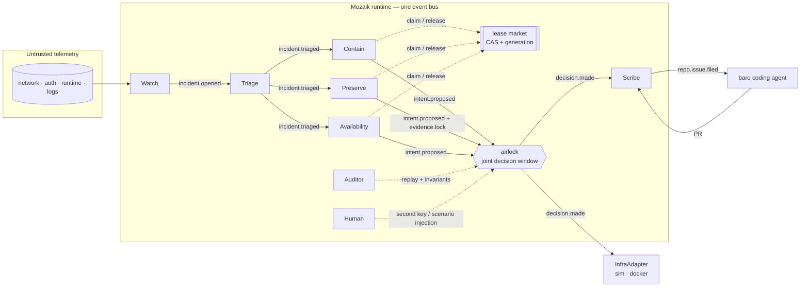

# 01 — Architecture

## One bus, seven mandates, one gate



Nobody calls anybody. Each participant reacts to events it cares about, publishes what it did, and
the airlock is the only path from intent to effect.

## Participants

| Participant | Mandate | May propose | May veto | Notes |
| --- | --- | --- | --- | --- |
| **Watch** | Turn telemetry into incidents | nothing | — | Cheap model or no model. High volume. Marks taint. |
| **Triage** | Name affected services and the smallest target set | nothing | — | Refuses to act on weak evidence. |
| **Contain** | Stop the harm | block, isolate, drain, revoke | — | Two proposals in one turn are normal; the airlock decides them together. |
| **Preserve** | Keep the evidence | snapshot, lock | destructive actions on locked targets | Lock is time-bounded and visible in state. |
| **Availability** | Keep the product up | scale, drain | blast over budget | Owns the budget number. |
| **Scribe** | Timeline, postmortem, issue, baro goal | nothing | — | Only writes claims the trace supports. |
| **Auditor** | Re-run invariants over the trace | nothing | any action without provenance | Deterministic. Can fail a run. |
| **Human** | Second key, scenario injection | any (wildcard capability) | anything | The only participant with `*`. |

Deliberate asymmetry: **the agents that want to act are not the agents that judge the act.** Contain
cannot approve Contain. That is the same reason a reviewer is a separate participant in EUREKA.

## Shared state

`CustodyState extends RuntimeState` (see `src/runtime/state.ts`):

| Field | Holds |
| --- | --- |
| `topology` | services, hosts, links, protected CIDRs — the dependency graph blast radius is computed from |
| `telemetry` | raw events by id; never mutated |
| `intents` | every proposal, including rejected ones |
| `decisions` | the airlock's verdict per intent, with votes and reason |
| `locks` | evidence locks: target, holder, reason, expiry |
| `incidents` | phase per incident (watch → triage → act → recover → closed) |
| `capabilities` | agent id → capability list |
| `secondKey` | intent ids a human approved |
| `config` | blast budget, decision window, mock flag |

The trace is a participant, not a debugging aid. In the wired system it subscribes to everything and
writes JSONL, exactly like `packages/eureka/src/runtime/trace.ts`.

## Concurrency: what is actually parallel

- **Pools, not a pipeline.** Contain, Preserve and Availability are separate agents with separate
  loops. They see the same `incident.triaged` event and start thinking at the same time.
- **One turn per worker.** A worker handles one item at a time; parallelism comes from the pool and
  from cross-role concurrency, not from a hidden queue inside one agent. This keeps
  `model.answer → intent` correlation unambiguous.
- **The decision window.** The airlock awaits for `windowMs` (default 1500 ms) after the first
  intent, then decides the set. That await is the mechanism: it is the only interval in which one
  agent's half-formed intent can change another's.
- **Leases, not assignments.** A claim carries a generation. A worker that stalls past its TTL
  cannot write back over the worker that replaced it. Reused from `packages/eureka/src/domain/market.ts`.
- **Human as a held lease.** A second-key request is an open lease; the trace shows the wait.

## Module map

```
src/
  domain/
    types.ts        Intent, Decision, Topology, EvidenceLock, TelemetryEvent   [implemented]
    topology.ts     demo fixture + blast helpers                               [implemented]
    registry.ts     closed action schema, compensation, narrowing              [implemented]
    invariants.ts   capability/provenance/taint/compensation/blast/evidence     [implemented]
  agents/
    airlock.ts      joint reconciliation + precedence rules                    [implemented, tested]
    airlock-handler.ts  Mozaik InterceptionHandler adapter                     [typed, not wired]
    roles.ts        role prompts                                               [text only]
    worker.ts       generic reactive worker                                    [TODO]
    pool.ts         role pools                                                 [TODO]
    scheduler.ts    boot + quiescence                                          [TODO]
  runtime/
    state.ts        CustodyState                                               [implemented]
    events.ts       event catalogue                                            [implemented]
    session.ts      defineRuntime                                              [implemented]
    trace.ts        JSONL observer                                             [TODO — lift from EUREKA]
  infra/
    adapter.ts      InfraAdapter interface                                     [TODO]
    sim.ts          digital twin                                               [TODO]
    docker.ts       real adapter                                               [TODO]
  scenarios/
    money.ts        the five-intent scenario                                   [implemented]
    *.ts            the rest of the suite                                      [TODO]
  index.ts          `bun run custody` replay                                  [implemented]
```

## What exists today, precisely

- 18 passing tests across three files: invariants, airlock, registry.
- `bun run custody` replays five concurrent intents and prints the decisions; exits non-zero if any
  outcome differs from the scenario's expectation.
- `tsc --noEmit` clean against the workspace Mozaik build.
- The Mozaik interception adapter compiles against v4.1.0 but has not been exercised in a live loop.

## What does not exist yet

The worker/pool that runs role prompts, the digital twin, the real adapter, the trace observer, the
viewer, the scenario suite beyond the money case, the ablation harness, and the baro handoff. Those
are the tickets in [10-wayfinder-seed](10-wayfinder-seed.md).
