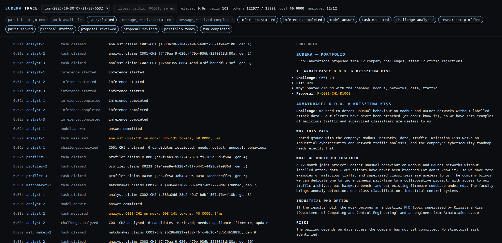
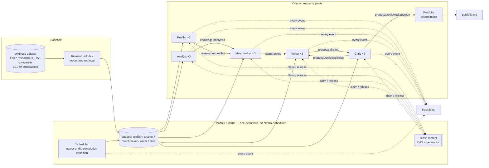
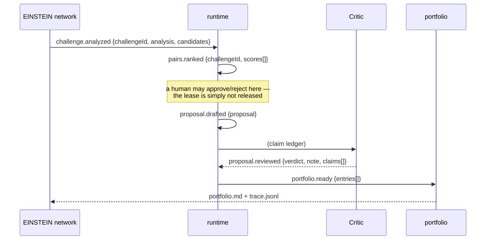

# EUREKA

**An evidence-first researcher–company matchmaker built on [Mozaik](https://github.com/jigjoy-ai/mozaik).**

EUREKA reads a company's real technical challenge, retrieves the researchers whose published
work actually overlaps with it, ranks the pairs, and writes an industrial-PhD or joint-project
proposal for the best ones — with a **Critic that rejects any sentence it cannot trace to a
dataset id**. It runs several agents at the same time, shares one typed state, and claims work
through a lease market instead of following a scripted pipeline.

Built for the **EINSTEIN: Science-to-Business Matchmaker** track of the NTP Novi Sad Hackathon
(30–31 October 2026).



*A real run in the trace viewer: 12 challenges, 103 model calls, **14 turns in flight at once**,
12 Critic rejections and 12 approvals. `bun run mock` reproduces it in about a second with no keys and no
network, then `bun run trace` opens this page.*

---

## What it does

```
challenge → capability needs → retrieval (no model) → ranked pairs → proposal → claim-level review
```

1. **Industry Analyst** turns each company challenge into the capability the company actually needs.
2. **Retrieval** (deterministic, no model) narrows 1,047 researchers to the handful whose
   keywords, fields and open-to statements genuinely overlap. This happens *before* inference:
   153 companies × 1,047 researchers is 160k pairs, and no budget survives throwing a model at that.
3. **Research Profiler** enriches the strongest candidates with a sourced profile.
4. **Matchmaker** ranks the pairs for that challenge and explains each ranking.
5. **Proposal Writer** drafts a one-page proposal — problem, first-year plan, what each side brings,
   industrial-PhD option, risks.
6. **Critic** checks every citation against the dataset, in code first and with a model second.
   A fabricated paper does not survive: the proposal goes back to the Writer, and if it fails
   twice it is abandoned rather than shipped.
7. **Portfolio** picks at most one collaboration per company, never double-books a researcher,
   and is allowed to leave a challenge unmatched — saying "no defensible pair" is a result.

The output is `runs/<id>/portfolio.md` plus `runs/<id>/trace.jsonl`: every task, its model, its
tokens, its cost and its duration.

---

## Does the matching actually work?

The trace proves sources resolve. It does not prove the *pairs are right*, so here is a measurement.

Twenty challenges were sampled across sectors, their retrieval top-5 printed (`eval/sheet.md`), and
every researcher whose stated fields, keywords or open-to statements credibly address the challenge's
specific need was labelled by hand (`eval/labels.json`). `bun run eval` recomputes the numbers from
those labels; `eval/results.json` is the output.

| Metric | Result | What it means |
| --- | --- | --- |
| **hit@3** | **84.2%** (16/19) | The shortlist handed to the Matchmaker contains a qualified researcher for 16 of 19 challenges |
| **precision@1** | **47.4%** (9/19) | Lexical retrieval alone picks the *right* one first about half the time |
| **precision@3** | **43.9%** | On average under half of the top three are genuine fits |
| **MRR** | **0.69** | When it is right, it is usually first or second |
| no qualified researcher in the top 10 | 1 of 20 | C113 (SAP connector maintenance) has no fit in the dataset — "no match" is correct |

Two honest readings:

1. **Retrieval is a shortlist generator, not a decision.** 84% hit@3 versus 47% precision@1 is
   exactly why the Matchmaker exists: it sees six candidates and a reason per candidate, and the
   25-point criterion is judged on *its* pick, not on the lexical order. Retrieval's job is to not
   lose the right person; it mostly succeeds and occasionally fails (C022: both geodesists who
   could fix a 2–4 m cadastral offset were ranked 4th and 5th; C008: the one LoRaWAN specialist was
   ranked 4th behind three manufacturing engineers).
2. **The labels are ours.** They are committed, with the sheet they were made from, so a reviewer can
   disagree with a label and recompute. That is the point — the alternative is an unverifiable claim
   of quality.

At the full scale in `examples/run-full/`: 12 challenges, **2 left unmatched on purpose**, 10
proposals, 7 approved after **9 Critic rejections** (3 abandoned after failing twice), portfolio of
5, 86 model calls, $0.17, 127 s.

---

## Why this is not a pipeline in disguise

A pipeline is a script that calls A, then B, then C. Here, **nobody calls anybody**:

- Every participant is an `Agent` or `Human` joined to one Mozaik runtime.
- Work is published as events (`work.available`, `challenge.analyzed`, `pairs.ranked`,
  `proposal.drafted`, `proposal.reviewed`).
- A worker **claims** an item from a queue through a lease market that carries a generation
  (`src/domain/market.ts`). A stale worker's write is discarded: `market.isCurrent(key, generation)`.
- Workers of the same role compete for the same queue. Adding a worker adds throughput; it does
  not change the code.
- The only coordinating participant, the **Scheduler**, owns no work. It publishes the initial
  work and closes the run when the market and the queues are empty. Remove it after boot and the
  run still drains — it just would not know when to stop.

Measured on the mock run in this repository: **14 model turns in flight at once** (the whole pool), across five
roles, with a max pool of 3. The trace proves it — `inference.started` minus `inference.completed`
over time is the concurrency curve.

---

## How to run it

Requires [Bun](https://bun.sh) 1.4+. From the repository root:

```bash
bun install
bun run mock                       # offline, deterministic, no API key, ~1s
bun start                          # real models (needs a provider key)
bun run trace                      # serve the trace viewer at http://localhost:4173
bun run openalex                   # optional: verify the OpenAlex key, pull UNS context
```

The same scripts work from this package directory (`cd packages/eureka && bun run mock`).

`bun run mock` is the honest demo: the runtime, the concurrency, the leases, the Critic and the
trace are all real. Only text generation is replaced by `src/inference/mock.ts`, which is labelled
`mock` in the trace. The first draft deliberately fabricates one citation so the rejection loop
is visible in every run.

### Real models

Copy `.env.example` to `.env` and set **one** provider key.

**OpenRouter** (what this repository was developed against — one key, any model):

```bash
OPENROUTER_API_KEY=sk-or-v1-...
EUREKA_MODEL=deepseek/deepseek-v4-pro          # matchmaker + writer
EUREKA_FAST_MODEL=deepseek/deepseek-v4.1-flash # profiler, analyst, critic
```

OpenRouter speaks OpenAI's chat-completions dialect, so it runs on Mozaik's generic
`OpenAIChatCompletions` adapter (`src/inference/openrouter.ts`) — no custom runner. Two details
that matter:

- Model ids are **OpenRouter ids** (`vendor/model`). The run declares them on
  `inferenceRunnerConfig.supportedModels`, because the runtime rejects an unknown model string
  before it makes a network call.
- `provider.sort: throughput` steers routing to the fastest upstream. The same writer prompt took
  48s on one route and 186s on another otherwise. `OPENROUTER_REASONING=1` re-enables reasoning;
  it is off by default because these models were spending 4–5k reasoning tokens on a one-page
  proposal. `OPENROUTER_EXTRA_BODY='{...}'` replaces the whole body fragment.

**Single provider** (bundled Mozaik model names):

```bash
OPENAI_API_KEY=...        # EUREKA_MODEL=gpt-5.5        EUREKA_FAST_MODEL=gpt-5.4-mini
ANTHROPIC_API_KEY=...     # EUREKA_MODEL=claude-sonnet-4-6  EUREKA_FAST_MODEL=claude-haiku-4-5
GEMINI_API_KEY=...        # EUREKA_MODEL=gemini-3.1-pro-preview  EUREKA_FAST_MODEL=gemini-3.5-flash
```

Any OpenAI-compatible endpoint (DeepSeek direct, vLLM, Ollama) works through `OPENAI_BASE_URL`.

### Measured

| | mock (offline) | OpenRouter, 2 companies / 2 challenges |
| --- | --- | --- |
| wall clock | 1.2s | ~30–60s |
| model calls | 103 | 12 |
| cost | $0.00 | ~$0.01 |
| concurrency | 14 turns in flight (full pool) | 3–5 turns in flight |

A full run at the default scale (6 companies, 12 challenges) is a few minutes and well under $0.25
on these models.

### Scale knobs

```bash
bun start -- --companies=10 --challenges=2 --candidates=6 --profile=3 --portfolio=5 \
              --pools=profiler:3,analyst:3,matchmaker:3,writer:3,critic:2
```

| Flag | Default | Meaning |
| --- | --- | --- |
| `--companies` | 6 | Companies to process (dataset has 153) |
| `--skip` | 0 | Skip the first N companies (demo a specific sector) |
| `--challenges` | 2 | Challenges per company (489 in total) |
| `--candidates` | 6 | Researchers retrieved per challenge |
| `--profile` | 3 | Candidates enriched with a model-written profile |
| `--portfolio` | 5 | Collaborations carried into the portfolio |
| `--pools` | 3/3/3/3/2 | Worker-pool size per role |
| `--lease-ttl` | 120000 | Lease lifetime in ms |

---

## Architecture



Full detail, event catalogue and design decisions: [`docs/architecture.md`](docs/architecture.md).

### Layout

```
src/
  domain/       types, dataset loading + retrieval index, lease market
  runtime/      runtime state, event catalogue, session, trace observer
  agents/       generic reactive worker, the five role prompts, pools, scheduler, portfolio
  inference/    mock runner, price table
  index.ts      CLI (run / trace)
  trace-server.ts  zero-dependency viewer server
public/viewer.html   the trace UI
data/data/           vendored synthetic dataset (see provenance below)
```

---

## The claim ledger

The brief's hardest requirement is *"no hallucinations"*. Prompting a model to be careful does not
achieve that, so the system does not rely on it:

- Every factual sentence in a proposal becomes a **Claim** object in `RuntimeState`:
  `{ text, sources[], status: proposed | verified | rejected, note }`.
- The Critic receives a **scoped** list of sources that could legitimately support *this* pair
  (the researcher, their publications, projects and patents, the challenge, the company) — not a
  prompt stuffed with 14k ids.
- **Code resolves every citation before the model's verdict is considered.** If one id does not
  exist in the index, the verdict is `reject` regardless of what the model said.
- Rejections are not silent. They are events (`proposal.reviewed`, `claim.rejected`), they are in
  the trace, and they cost the Writer another turn.
- Two failed revisions and the proposal is abandoned. The portfolio is smaller and honest.

`runs/<id>/portfolio.md` therefore contains only claims whose sources resolve.

---

## How this maps to the judging criteria

| Criterion | Pts | Where it is answered |
| --- | --- | --- |
| Multi-agent architecture: roles, coordination, review loops | 30 | Five role pools on one bus, lease market with generations, Critic→Writer revision loop. `src/agents/`, `src/domain/market.ts` |
| Proposals a company and a researcher would sit down over | 25 | Challenge-specific problem restatement, first-year plan, what each side brings, industrial-PhD option, named risks. `src/agents/roles.ts` (writer), `runs/*/portfolio.md` |
| Accuracy and transparency: sources, trace, no hallucinations | 20 | Claim ledger + code-level citation resolution + `trace.jsonl` with per-task time and cost. `src/agents/roles.ts` (critic), `src/runtime/trace.ts` |
| Potential for real use in EINSTEIN | 15 | Deterministic retrieval scales to the full dataset; portfolio instead of leaderboard; integration sketch below |
| Responsible use of data | 10 | Synthetic dataset only by default; no scoring or ranking of people by worth; "no match" is a first-class outcome; unmatched challenges are reported |

Required extras from the brief:

- **Architecture diagram** — §Architecture and `docs/architecture.md`.
- **Trace of one full run, showing where the Critic stepped in** —
  `examples/run-openrouter/trace.jsonl` (real OpenRouter run, 3 proposals, 1 challenge left
  unmatched). Every `proposal.reviewed` entry carries the verdict, the Critic's note and the claim
  ledger (`data.claims`). `examples/run-mock/` is the same system with the rejection loop forced,
  for a zero-cost look. See [`examples/README.md`](examples/README.md).
- **At least three proposals** — `examples/run-openrouter/portfolio.md`.

---

## How this plugs into the EINSTEIN network and EINSTEIN Stars

*Our reading of the brief. The seams below are implemented; the surrounding platform details are assumptions, marked as such.*

The unit of exchange is **not a score and not a chatbot**. It is a *claim-backed proposal*: a pair,
a problem, a plan, and every factual sentence tied to an id that resolves. That is what makes this
composable with a network rather than another silo.

### 1. The event seam (implemented)

Everything a host needs is on the bus, and nothing is hidden in a CLI:



A host integrates by posting a challenge and reading `proposal.reviewed`; it never imports our
agents. The reverse also works: our runtime can join a network's event bus as one more participant,
because `RuntimeState` and `SemanticEvent` are the framework's public vocabulary, not ours.

### 2. EINSTEIN Stars: evidence cards, not a leaderboard

A researcher profile in EUREKA is a set of claims — `{ text, sources[], status }` — not a rank.
That maps directly onto a "why is this person a candidate?" card in Stars:

| Stars needs | EUREKA already produces |
| --- | --- |
| Who is this researcher? | `researcher.profiled` with sourced expertise and open-to statements |
| Why are they being suggested? | `pairs.ranked` with a reason and a named risk per pair |
| Can I check it? | every claim carries dataset/ORCID/OpenAlex-shaped ids |
| What is *not* claimed? | unmatched challenges and abandoned proposals are in the trace |

The last row matters most. A network that only shows matches learns nothing from the ones that
should not exist.

### 3. Human approval is a lease, not a meeting

The brief suggests a person approves pairs before writing. In this runtime that is one participant
that reacts to `pairs.ranked` and calls `market.claim(...)` without releasing it until a human
answers — the same mechanism that already stops a second Critic from taking a proposal. No new
workflow engine, no polling, and the wait is visible in the trace as an open lease.

### 4. Provenance: where CORDIS and OpenAlex fit

Real public data cannot make a synthetic claim true, so we do not let it. Its honest job is
**context and checking**:

- **CORDIS (historical record).** For a pair, look up prior EU-funded projects in the same field and
  report them as *real-world context*: "this research area has N funded Horizon projects, e.g.
  ACRONYM". That supports a reviewer's judgement about whether the area is fundable — it does not
  verify anything about the fictional researcher, and the claim type would say so.
- **OpenAlex (present record).** Resolve a real UNS author into a proposal's "why this pair" only
  after matching their ORCID/OpenAlex id, with the id printed next to the sentence.
- **The rule stays.** A `sourceType: "cordis" | "openalex"` claim is checked against those APIs at
  review time the same way a `SYN-PUB-…` claim is checked against the dataset. If the id does not
  resolve, the proposal is rejected — the Critic does not care where the evidence came from.

We prototyped live *open-call* matching and removed it: the portal exposes titles only, and wrong
calls in proposals cost more than no calls. Prior-project provenance is the version of that idea
that cannot lie about the pair.

### 5. Deployment sketch

| Mode | What runs | Why it fits |
| --- | --- | --- |
| Local CLI (today) | `bun run mock` / `bun start` | A jury can reproduce a full run offline in one second |
| Service behind the portal | one long-lived runtime, challenges posted as events | The network keeps its UI; EUREKA is a matching backend |
| Batch/offline | `--companies=153` over a nightly corpus | Portfolios per faculty/sector, no live model calls during review |

The trade-off we would defend: **stateless agents per turn, stateful runtime per session.** Any
participant can be restarted or replaced without losing the run, because nothing important lives in
a model's context window — it lives in `RuntimeState` and the trace.

---

## Data

`data/data/` is the organisers' synthetic dataset
([`jigjoy-ai/einstein-matchmaker-data`](https://github.com/jigjoy-ai/einstein-matchmaker-data)),
vendored so the repository runs without network access: 1,047 researchers, 153 companies,
489 challenges, 10,779 publications, 1,823 projects, 111 patents, 917 company pages. Every person
and company is fictional; the faculties are real and used only as a setting.

An optional enrichment probe reads `OPENALEX_API_KEY` from `.env` (free key:
<https://openalex.org/settings/api-key>). It is **not** required for a run, and the pipeline never
sends real people to a model: enrichment is limited to resolving public identifiers.

**Responsible use.** The system proposes collaborations between institutions. It does not score,
rank or rate people by worth. Retrieval ranks *overlap with a stated problem*, and the
`unmatched` list exists so a weak pair is reported as weak rather than dressed up.

---

## Honest limitations

- **Mock mode is deterministic fiction.** It proves the machinery, not the proposal quality.
  Real-mode output quality depends on the provider and the prompt; the Critic guards facts, not taste.
- **Retrieval is lexical.** Serbian Cyrillic and Latin records are not transliterated yet, so a
  Cyrillic-only profile can be under-retrieved. The dataset has 82 such records. Fix: a
  transliteration pass in `tokenize` (`src/domain/dataset.ts`), ~20 lines.
- **Profiles are per-challenge.** The same researcher may be profiled several times for different
  challenges. A cross-run profile cache is the obvious next step.
- **Embeddings would beat keyword overlap** for cross-disciplinary pairs ("formal verification" ×
  "medical devices"). Retrieval is deliberately model-free so the run stays cheap and testable;
  swapping in an embedding index is a single class change behind `ResearcherIndex`.
- **Portfolio is greedy.** No global optimisation (e.g. max-coverage with mutual exclusivity);
  with 153 companies that is a real, if small, quality gap.
- **No persistence between runs.** State lives in memory; `runs/` is the durable artefact.
- **CORDIS institutional provenance was probed and dropped.** A live probe found 84 EU-funded
  projects with a University of Novi Sad participant (Sciences 35, Agriculture 17, Technical
  Sciences 14, Technology 11), which is real and verifiable. But ranking those projects against the
  20 labelled challenges produced **0 matches at a two-term relevance floor**, and the best-scoring
  pairs were generic-word coincidences — a Modbus anomaly-detection challenge "matched" a
  multilingual-dialogue project on `data`, `build`, `loop`. CORDIS supports an institutional
  footnote ("this faculty has run 35 EU projects"), not a pair-level citation, and a footnote is
  not worth a section. The finding is recorded here rather than shipped as decoration.
- **Open-call matching was prototyped and removed.** A Funding Scout attached live Horizon Europe
  calls to each pair. The portal's search API returns only the topic *title* — the `topicDetails`
  JSON endpoint that used to carry descriptions now 404s — so ranking ~314 open topics on keywords
  produced false pairs: a Modbus/OT-security challenge matched a built-environment call, and a
  game-development challenge matched a space-transport call at 100% "confidence". Gating the choice
  behind the Matchmaker made it fire almost never. Shipping a wrong call in a proposal is worse than
  shipping none, so the feature is out. If a call source with descriptions appears, the integration
  point is `pairs.ranked`; the deterministic citation check already knows how to verify a call id.

---

## Trace format

`runs/<id>/trace.jsonl`, one JSON object per event:

```json
{"t":124,"ts":"2026-10-29T19:18:11.333Z","type":"task.measured","producer":"writer-1",
 "summary":"writer P-C001-CH1-R1008 on gpt-5.5: 1273→564 tokens, $0.0072, 4ms"}
```

`bun run trace` serves the viewer (`public/viewer.html`): a timeline with filters, expandable
payloads, live cost/token counters, red rejections and green approvals, plus the portfolio beside it.

---

## Licence

MIT.
